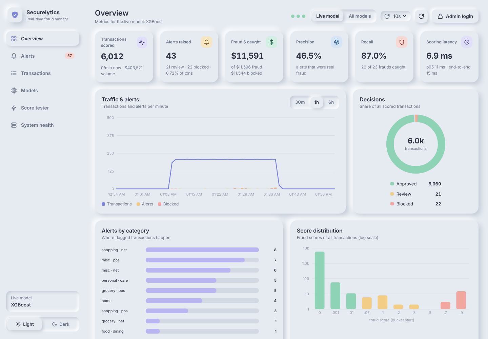
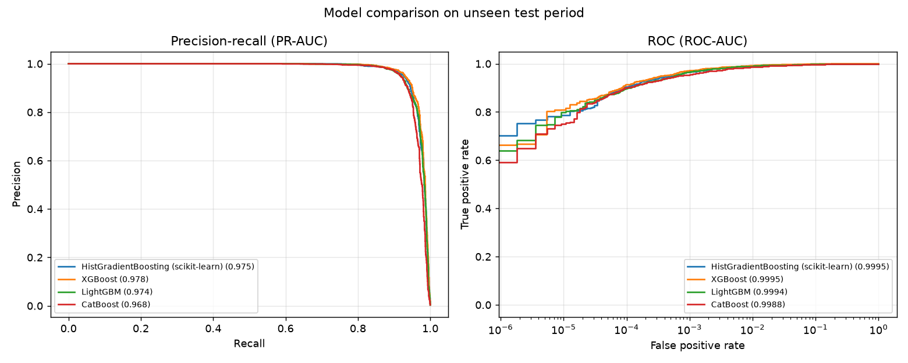
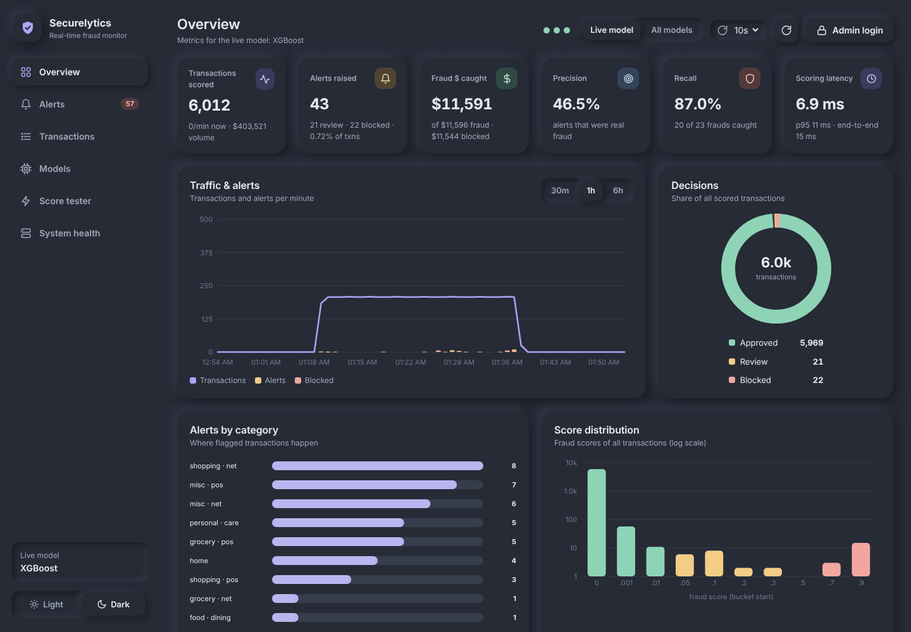
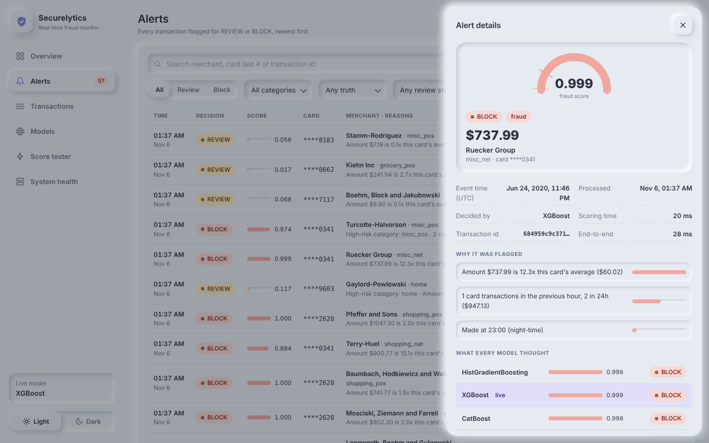
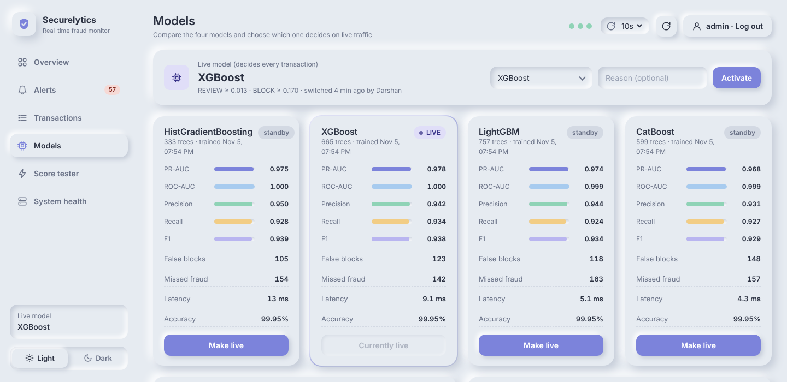
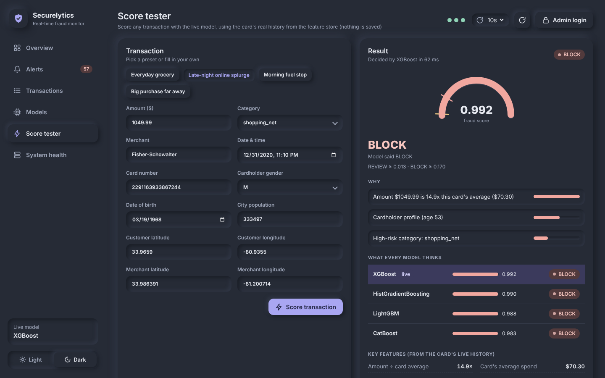
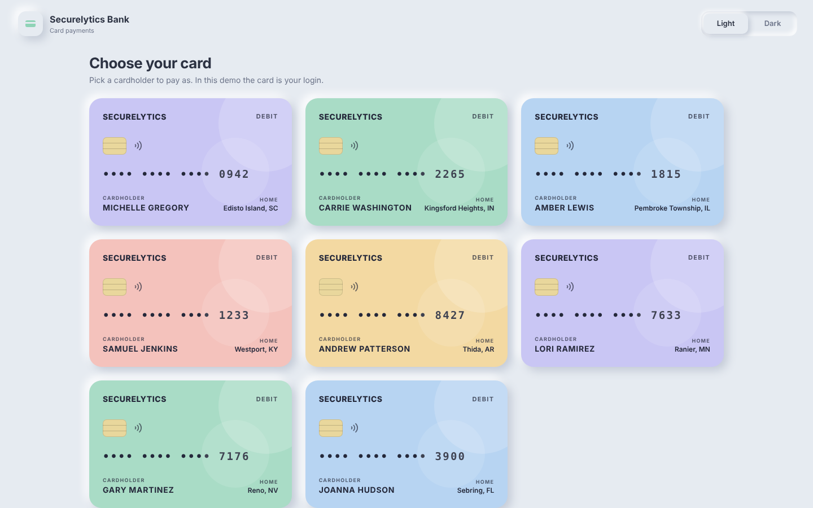
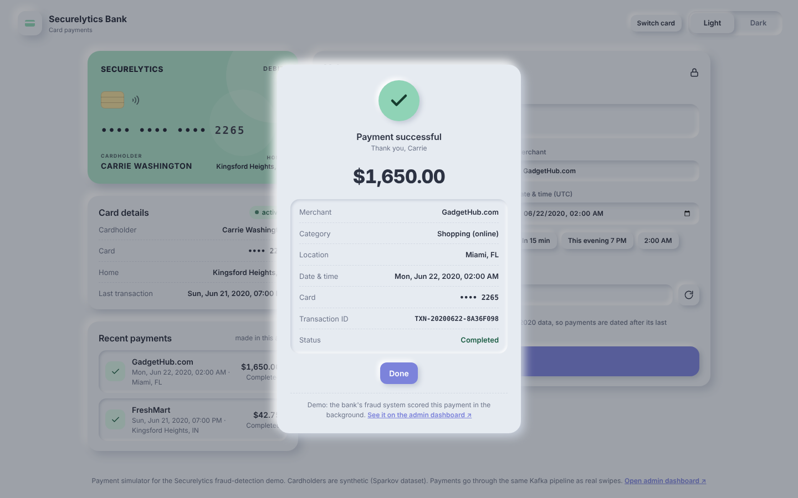
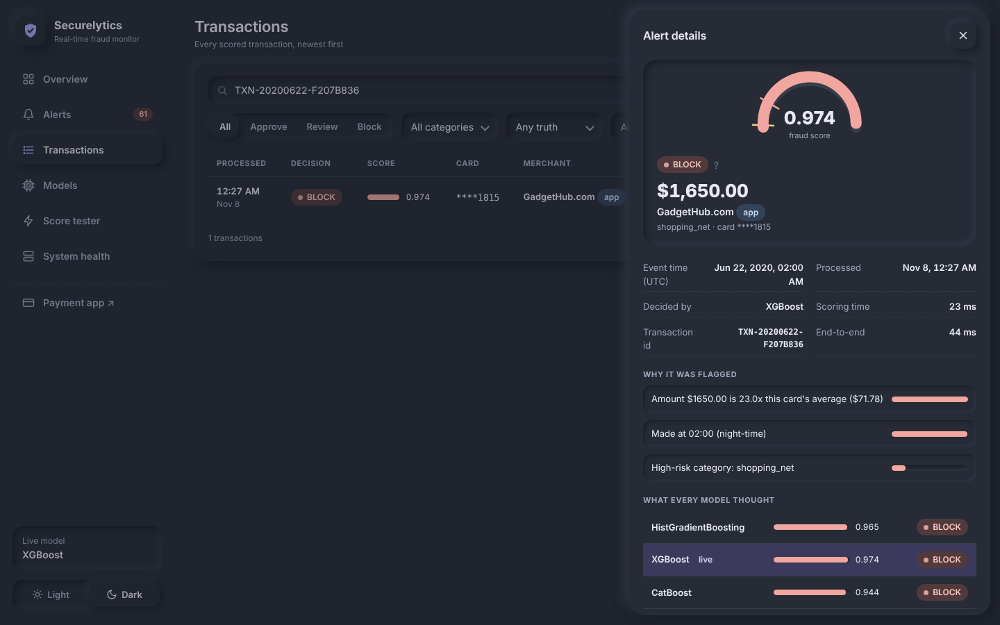

# Securelytics: Real-Time Fraud Detection Pipeline


A streaming system that scores every card transaction for fraud **as it happens**:
Kafka → stream processor (Redis feature store + ML models + rules) → Postgres → live dashboard,
with an explanation for every alert. Four models (HistGradientBoosting, XGBoost, LightGBM, CatBoost)
are trained and compared, and a **web dashboard** (light + dark theme) lets an admin switch the live model with one click.



```
 fraudTest.csv ──► Producer ──► Kafka [transactions] ──► Stream processor ──► Kafka [fraud-alerts]
 (+ injected attacks)                                    │   1. validate & clean      │
                                                         │   2. dedupe (Redis)        ▼
                                Redis feature store ◄───►│   3. card-history features  Postgres ──► Web dashboard (:8501)
                                (card history, 7-day     │   4. ML score + rules           │
                                 windows, merchants)     │   5. decision + reasons         └──► FastAPI (/score, /alerts)
                                                         └── invalid events ──► Kafka [transactions-dlq]
```

## Results (unseen test period: Jun 21 – Dec 31, 2020, 555,719 transactions)



`reports/model_comparison.md` holds the full table for all trained models; it's regenerated by every training run.

| Model | PR-AUC | ROC-AUC | Accuracy | Precision | Recall | F1 | False blocks | Missed fraud | Latency p50 |
|---|---|---|---|---|---|---|---|---|---|
| **XGBoost** (default: best on validation) | **0.9776** | 0.9995 | 99.952% | 94.2% | **93.4%** | 0.938 | 123 | **142** | 9.1 ms |
| HistGradientBoosting | 0.9751 | 0.9995 | 99.953% | **95.0%** | 92.8% | **0.939** | **105** | 154 | 13.3 ms |
| LightGBM | 0.9742 | 0.9994 | 99.949% | 94.4% | 92.4% | 0.934 | 118 | 163 | 5.1 ms |
| CatBoost | 0.9683 | 0.9988 | 99.945% | 93.1% | 92.7% | 0.929 | 148 | 157 | **4.3 ms** |
| Logistic regression (baseline) | 0.3248 | 0.9873 | 99.488% | 40.0% | 65.4% | 0.496 | 2,105 | 743 | - |

(Precision, recall, F1 and accuracy are at each model's BLOCK threshold.)

**Takeaways**
- All four boosted-tree models land within 1 PR-AUC point of each other; the features matter far more than
  the library (the same features in a logistic regression reach only 0.32).
- **XGBoost** catches the most fraud (fewest misses) and is the default live model.
  **HistGradientBoosting** blocks the fewest good customers. **CatBoost** is fastest but slightly less accurate.
  That's exactly the trade-off the admin panel lets you switch between.
- At the REVIEW threshold XGBoost flags **96.9% of fraud** with 81% precision, catching **$1.12M of $1.13M**.
- Latency is single-transaction scoring on a laptop CPU.

> Accuracy looks great for every model (even "approve everything" scores 99.6%) because fraud is only 0.4% of
> transactions. That's why models are compared on PR-AUC, recall and false blocks.

Charts: `reports/model_comparison_curves.png` (PR + ROC curves), `reports/model_comparison_bars.png`, `reports/eda/`.
Data cleaning report: `reports/data_quality.json`.

> **Honest caveat:** Sparkov is simulated data with cleaner fraud patterns than real life. Real-world
> PR-AUC is typically much lower. The engineering (stream processing, feature parity, thresholds by cost,
> explanations) is what transfers.

## Tech stack

| Layer | Tool |
|---|---|
| Streaming | Apache Kafka 3.9 (KRaft, no Zookeeper), `confluent-kafka` client |
| Feature store | Redis 7 (hashes, sorted-set time windows, sets) |
| ML | HistGradientBoosting (scikit-learn), XGBoost, LightGBM, CatBoost; logistic regression baseline |
| Storage | PostgreSQL 16 |
| API | FastAPI |
| Dashboard | Starlette JSON API + vanilla JS single-page app (neumorphic UI, light/dark, hand-made SVG charts, no build step) |
| Ops | Docker Compose, Kafka UI, pytest |

## Project structure

```
Securelytics/
├── .github/workflows/        CI: runs the test suite on every push
├── data/raw/                 fraudTrain.csv, fraudTest.csv (download from Kaggle, not committed)
├── src/securelytics/
│   ├── cleaning.py           data validation & cleaning (batch + streaming, identical rules)
│   ├── features.py           22 real-time features (velocity, amount ratios, distance, time...)
│   ├── store.py              feature stores: in-memory (training) and Redis (production)
│   ├── prepare.py            STEP 1: clean data, build features, card-history snapshot
│   ├── train.py              STEP 2: train 4 models, tune thresholds by cost, compare, plots
│   ├── registry.py           which models exist + which one is live (Redis)
│   ├── live_metrics.py       per-model live metrics from shadow scores
│   ├── dashboard_data.py     SQL queries behind the dashboard
│   ├── payments.py           payment app: cardholders, payment -> raw card event
│   ├── eda.py                exploratory charts
│   ├── model.py              model wrapper: score, decide, explain (reason codes)
│   ├── rules.py              expert rules (card testing, velocity) that can escalate decisions
│   ├── scoring.py            the real-time engine: raw event → decision
│   └── db.py                 Postgres writes
├── services/
│   ├── producer.py           replays fraudTest.csv into Kafka, can inject attacks
│   ├── processor.py          Kafka consumer → scoring → Postgres + alerts topic
│   ├── api.py                REST API for integrations (score, alerts, list/switch models), OpenAPI docs
│   ├── web.py                web dashboard backend (JSON API + serves the frontend)
│   └── static/               frontends: dashboard (index.html, app.js, charts.js) + payment app (pay.html, pay.js)
├── storage/schema.sql        tables: transactions, alerts, dead_letters, model_switches
├── models/                   4 trained models (<name>.joblib) + registry.json
│                             (card_state_snapshot.json is generated locally, not committed)
├── reports/                  model comparison, data quality, EDA charts
├── docs/images/              dashboard screenshots
├── notebooks/                train_on_colab.ipynb: train all 4 models on Google Colab
├── tests/                    39 tests incl. batch/stream parity, offline/online parity, model switching
├── run_training.bat          Windows one-click training
├── run_report.bat            Windows one-click report/charts
├── docker-compose.yml, Dockerfile
└── requirements.txt, requirements-boosting.txt, requirements-models.txt (exact versions of the trained models)
```

## How to run (Windows / Mac / Linux)

**Prerequisites:** Docker Desktop (give it at least 4 GB of RAM). Python 3.13 only if you train without Docker.

1. **Get the data.** Download the [Credit Card Transactions Fraud Detection dataset](https://www.kaggle.com/datasets/kartik2112/fraud-detection)
   from Kaggle and put `fraudTrain.csv` and `fraudTest.csv` in `data/raw/`
   (the Kaggle layout `data/raw/fraudTrain.csv/fraudTrain.csv` also works).
2. **Create your settings file** and set your own passwords:
   ```bash
   copy .env.example .env        # Mac/Linux: cp .env.example .env
   ```
   Edit `.env`: `ADMIN_PASSWORD` (required for the admin panel) and `POSTGRES_PASSWORD`.
3. **Build and prepare** (one time):
   ```bash
   docker compose build
   docker compose run --rm trainer python -m securelytics.prepare
   ```
   The four trained models are already in `models/`. `prepare` cleans the data and creates the card-history
   snapshot that warms up the live feature store (~2 min). To **retrain all four models** instead
   (~15–20 min), run `docker compose run --rm trainer`.
4. **Start everything:**
   ```bash
   docker compose up
   ```
5. **Open:**
   - Dashboard: http://localhost:8501 (admin login with the password from `.env`)
   - Payment app (make your own card payments): http://localhost:8501/pay
   - API docs (try `/score`, `/models`): http://localhost:8000/docs
   - Kafka UI (see topics and messages): http://localhost:8080
6. **Stop:** `Ctrl+C`, then `docker compose down` (add `-v` to wipe the database).

Run the tests inside Docker with `docker compose run --rm tests`.
If you change `POSTGRES_PASSWORD` after the first start, run `docker compose down -v` once so the database
is recreated with it.

Change the replay speed or attack frequency in `.env` (`EVENTS_PER_SEC`, `ATTACK_EVERY_SEC`).

### Train on Google Colab instead (saves laptop space)
1. Upload the `src` folder to Google Drive as `MyDrive/Securelytics/src`.
2. Open `notebooks/train_on_colab.ipynb` in Colab (File → Upload notebook) and run all cells (~20–30 min).
   The dataset is downloaded from Kaggle automatically, or read from `MyDrive/Securelytics/data/raw/`.
3. Download `securelytics_models.zip` and unzip it into the project folder (replace files). It contains
   `models/`, `reports/` and `requirements-models.txt` (the exact library versions used on Colab).
4. `docker compose build` installs those versions, so the models load correctly; then `docker compose up`.

### Without Docker (Windows one-click)
- `run_training.bat`: first run creates `.venv` and installs everything, then cleans data, trains all 4 models
  and makes the charts.
- `run_report.bat`: rebuilds the comparison table and charts from the trained models (no retraining).

### Without Docker (manual)
```bash
python -m venv .venv && .venv\Scripts\activate      # Mac/Linux: source .venv/bin/activate
pip install -r requirements.txt -r requirements-boosting.txt
set PYTHONPATH=src                                   # Mac/Linux: export PYTHONPATH=src
python -m securelytics.prepare                       # ~1 min: clean + features + snapshot
python -m securelytics.train                         # all 4 models (or: --models xgboost catboost)
python -m securelytics.eda                           # EDA charts
python -m securelytics.report                        # rebuild comparison table/charts without retraining
pytest -q                                            # 39 tests
```

## Dashboard

Open **http://localhost:8501**. Light and dark themes (toggle in the sidebar, remembered per browser), soft
neumorphic surfaces and solid pastel colours, responsive down to phone width.

| Page | What you can do |
|---|---|
| **Overview** | KPIs (transactions, alerts, fraud $ caught, precision, recall, latency), traffic and alerts per minute, decision split, alerts by category, score distribution, latest alerts. Switch between *live model* and *all models* metrics. |
| **Alerts** | Search (merchant, card last 4, id), filter by decision, category, ground truth, review status and model, paginate. Click an alert for its score gauge, reasons, what every model thought, key features, and to **label it** (confirm fraud / legitimate) for the feedback loop. |
| **Transactions** | Every scored transaction with the same search and filters. |
| **Models** | The four models side by side (PR-AUC, ROC-AUC, precision, recall, F1, false blocks, missed fraud, latency), offline comparison chart, live shadow-scoring comparison, actual decisions per model, switch history. **Admins switch the live model here.** |
| **Score tester** | Score any transaction with the live model using the card's real history (presets included). Nothing is saved. |
| **System health** | Database, Redis, stream processor (heartbeat) and model status, dead-letter queue (personal data redacted), troubleshooting commands. |

If Postgres, Redis or the processor is down, the dashboard says so with the exact command to fix it, instead of
showing an error page. It auto-refreshes every 10 s (configurable) and pauses while a detail panel is open.

| Dark theme | Alert details |
|---|---|
|  |  |
| **Model management (admin)** | **Score tester** |
|  |  |

## Payment app: make a payment and watch the model judge it

Open **http://localhost:8501/pay** (also linked from the dashboard sidebar). It plays the customer's side:

1. **Choose your card**: 8 cardholders from the dataset (busy cards with no fraud history). In this demo the card is your login.
2. **Make a payment**: amount, category, merchant, location (near home or another US city), date and time, and an auto-generated transaction ID.
3. **Payment successful**: the customer always gets a receipt. Like a real bank, the fraud decision happens in the background.

Behind the scenes the payment is published to Kafka exactly like a replayed card swipe, so it goes through the normal
pipeline: validation, the card's real history from Redis, the **trained live model**, the rules, Postgres. Nothing
in the payment app decides anything: the result on the admin dashboard is purely the model's output. Payments made
in the app have no ground-truth label (shown as **?**), just like real payments; an analyst can label them.

The receipt links straight to the transaction on the admin dashboard (marked **app**). Try a normal grocery payment
in the afternoon, then a large online purchase at 2 AM in another city, and compare.

**Simulation clock:** each card's history comes from the replayed 2020 data, so payments are dated just after the
card's last real transaction (within 7 days). Using today's date would make every card look inactive for years,
which no model has seen in training.

| Choose a card | Receipt (customer view) | Same payment on the admin dashboard |
|---|---|---|
|  |  |  |

### Switching the live model
Log in with **Admin login** (top right; name + `ADMIN_PASSWORD` from `.env`), open **Models**, pick a model and
click **Activate** (or **Make live** on a model card). The choice is stored in Redis; the stream processor checks
it before every batch and switches within about a second, with no restart. Every switch is logged (who, when, why).
The same switch is available from the REST API: `PUT /models/active` with header `X-Admin-Token`.
Newly trained models are picked up automatically when `models/registry.json` changes.

## How it works

### 1. Data cleaning (`cleaning.py`)
| Check | Finding in this dataset | Action |
|---|---|---|
| Missing values, duplicates | none (0 rows) | rules still enforced for live data |
| `unix_time` column | does **not** match `trans_date_trans_time` (offset varies per row) | dropped; event time parsed from timestamp |
| Merchant names | every name has a `fraud_` prefix (generator artefact) | prefix stripped |
| PII (name, street, city, zip, job) | not needed by the model | dropped at ingestion; card stored only as hash + last 4 digits |
| Invalid values | amount ≤ 0, bad coordinates, unknown category/gender, implausible age | rejected (offline: dropped & counted; live: dead-letter queue) |
| Outliers | 1,297 amounts above p99.9 | **kept**: large amounts are a fraud signal; handled with log-scaling and per-card ratios |
| Leakage | train/test overlap, time order | checked: 0 overlapping ids, test strictly after train |

The same rules exist as a vectorised batch function and a per-event function; a test proves they produce identical output.

### 2. Features (`features.py`): computed from each card's history *before* the transaction
- **Transaction:** amount, log amount, category, hour, day of week, night flag, weekend flag
- **Customer/merchant:** age, city population, gender, customer–merchant distance (haversine)
- **Behaviour:** number of prior transactions, card's average amount, amount ÷ average, z-score, time since last transaction
- **Velocity:** transactions in last 1h / 24h / 7d, amount spent in 24h, amount ÷ 7-day average
- **Novelty:** first time this card uses this merchant

**No training/serving skew:** training replays the data through an in-memory store, and production uses Redis,
but both call the same `compute_features`. The processor starts from a snapshot of card history at the end of the
training period, so live features match offline ones exactly (verified by `test_live_path_reproduces_offline_scores`).

### 3. Models & thresholds (`train.py`)
- Four gradient-boosted tree libraries trained on **identical data** with comparable settings (learning rate 0.05,
  ~63 leaves, fraud weighted 5x, early stopping on validation), plus a logistic-regression baseline.
- Out-of-time split: fit on the first 80% of the training period, tune on the last 20%, test on a later unseen period.
- The default live model is the best on **validation** PR-AUC (picking by test score would leak the test set).
- Each model gets its **own thresholds** (score scales differ between libraries), chosen by **money**:
  - **BLOCK**: lowest threshold with ≥ 95% precision, so few good customers are blocked
  - **REVIEW**: maximises fraud $ caught − $10 × false alerts

### 4. Rules (`rules.py`)
The model only knows patterns in its training data. Injected **card-testing attacks** (tiny charges, then a big
purchase) were missed by the model alone, so rules catch them. Rules can only escalate a decision. On the
555k test transactions they fired 23 times (1 false BLOCK).

### 5. Explanations (`model.py`)
Each alert lists its top reasons, found by replacing groups of features with a "typical legitimate" value and
measuring the score drop. Example (the API's sample request, score 0.99 → BLOCK): *"Amount $1049.99 is 14.9x this card's average ($70.30)"*, *"High-risk category: shopping_net"*.

### 6. Reliability (`processor.py`)
- Kafka key = card number, so each card's events stay in order on one partition
- Offsets are committed only after results are written (at-least-once), and Redis dedupe makes replays harmless
- Invalid events go to a dead-letter topic and table instead of crashing the processor

## What to explore next
1. Add hyperparameter tuning (Optuna) per model, and MLflow to track every training run
2. Retrain with analyst labels from the dashboard (`alerts.analyst_label`) to close the feedback loop
3. Add a second channel: PaySim mobile-money transactions on their own topic and model
4. Add Prometheus + Grafana for latency/throughput monitoring
5. Monitor feature drift (score distribution, alert rate) and trigger retraining
6. Scale out: more `transactions` partitions and `docker compose up --scale processor=3`

## Dataset & disclaimer
Data: [Sparkov simulated credit card transactions](https://www.kaggle.com/datasets/kartik2112/fraud-detection)
(Kaggle). All transactions, people and card numbers are synthetic. This is a learning/portfolio project, not a
production fraud system.

## License
[MIT](LICENSE)
